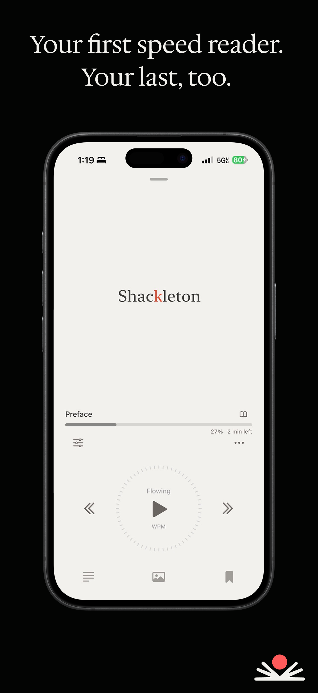
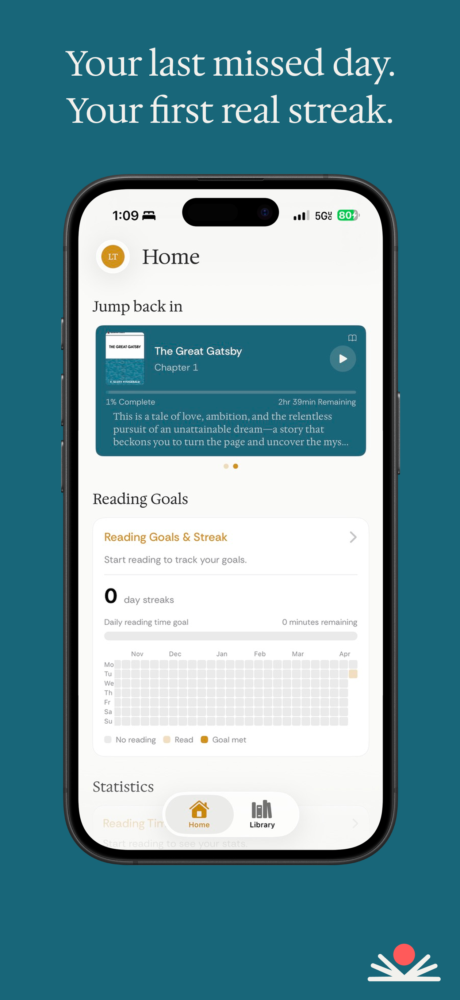
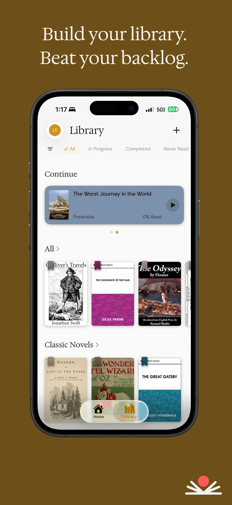
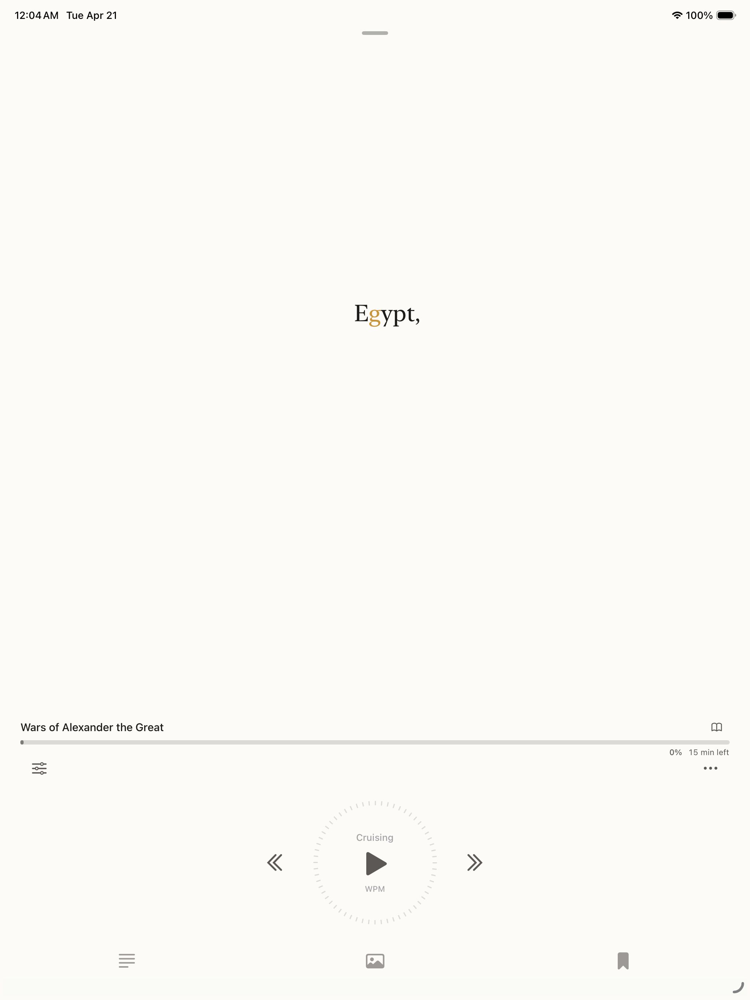
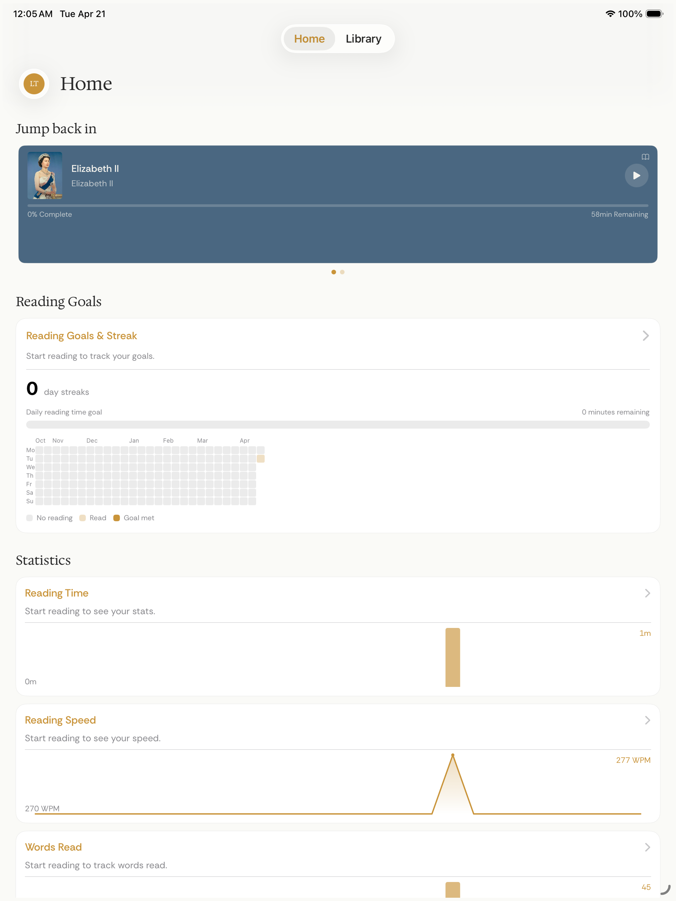
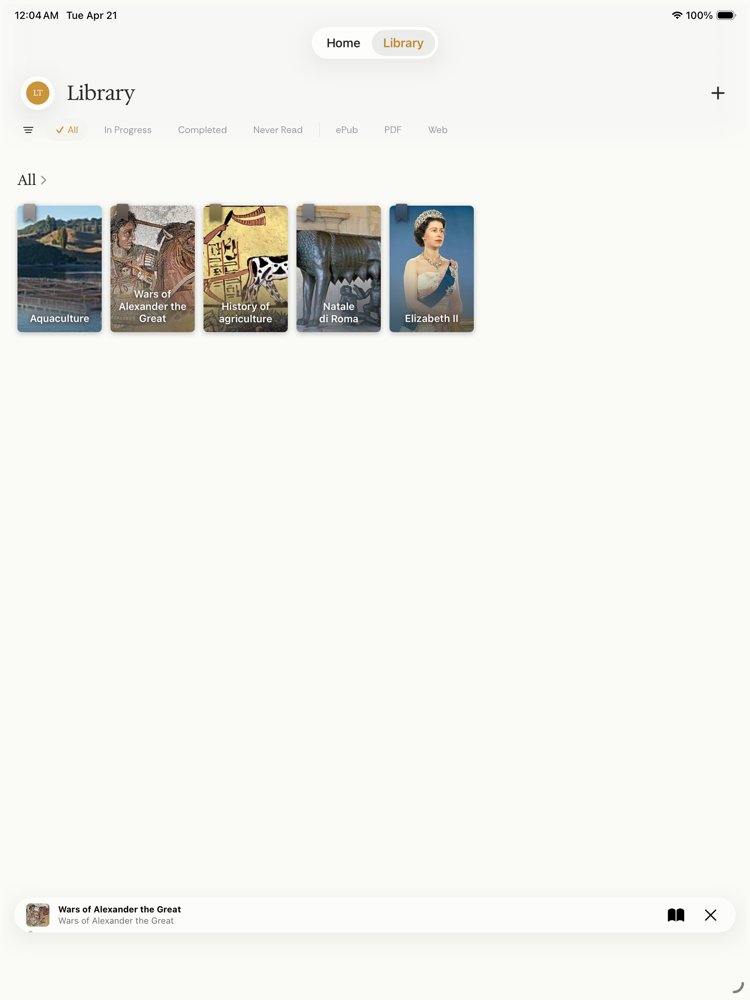

<div align="center">
  

  # Last First Words

  **Your first speed reader. Your last, too.**

  [](https://apps.apple.com/us/app/last-first-words/id6762709539)

  [App Store](https://apps.apple.com/us/app/last-first-words/id6762709539) · [Website](https://lastfirstwords.com) · [Privacy](https://lastfirstwords.com/privacy.html) · [Support](mailto:app@lastfirstwords.com)
</div>

---

Last First Words is an iOS e-reader built around a single idea: the fastest way to finish a book is to actually read it. It streams one word at a time at a pace you set, so your eyes stop hunting and your mind stops wandering — then it keeps the rest of the reading experience (your library, your goals, your streaks) quietly out of the way until you need it.

Import an EPUB, a PDF, or a web article. Pick a speed from a gentle walk to a dead sprint. Press play.

## Mission

Most readers do not have a reading problem. They have a backlog problem. Books get bought and shelved, articles get saved and lost, highlights pile up and never get revisited. Last First Words exists to shrink the gap between what you want to read and what you actually finish — without turning reading into a productivity grind.

- **Finish more of what you start.** Speed reading is the engine; the point is throughput, not showing off a WPM number.
- **One library, one place.** Books, PDFs, and the articles you shared from Safari all live together.
- **Your reading is yours.** Everything about what you read, when you read it, and what you highlighted stays on your device.

## Screenshots

<div align="center">
  
  
  
</div>

<details>
  <summary>iPad</summary>
  <div align="center">
    
    
    
  </div>
</details>

## Features

- **Dual-mode reader** — single-word Spritz mode for pace, or a continuous Stream mode when you want the context back.
- **Universal library** — import EPUBs, PDFs, and web articles from Safari via the Share Extension.
- **Reading goals and streaks** — a daily minute goal and a year-at-a-glance contribution grid.
- **Reading stats** — words per minute, time read, books finished, momentum over time.
- **Session recaps** — on-device AI generates short, spoiler-aware recaps so you can jump back in without re-reading.
- **Chapter-aware navigation** — bookmarks, chapter list, and quick scrubbing.
- **Themes that match the hour** — a Literary Journal design that shifts color temperature across the day.
- **Private by default** — no analytics, no tracking, no ads.

## Download

Last First Words is free on the App Store for iPhone and iPad.

**[Download on the App Store →](https://apps.apple.com/us/app/last-first-words/id6762709539)**

Requires iOS 26.0 or later.

## Tech Stack

- **iOS app** — Swift and SwiftUI, MVVM, actor-isolated services (`CanonicalParsingService`, `ResourceCacheActor`, `DocumentStoreActor`)
- **Reading engine** — tokenized canonical documents feeding a dual-mode (Spritz / Stream) reader
- **On-device AI** — Apple Foundation Models for session recaps and summaries; nothing leaves the device
- **Share Extension** — accepts articles, EPUBs, and PDFs shared from Safari and other apps
- **Backend** — Supabase for authentication only (library data stays local)
- **Companion service** — FastAPI (`agent_service/`) for optional curation agents
- **Typography** — Hedvig Letters Serif, Rethink Sans, Fraunces

## Repo layout

```
LastFirst/
├─ LastFirst/            # SwiftUI app source (Views, ViewModels, Services, Models)
├─ ShareExtension/       # iOS share extension for importing articles and docs
├─ LastFirstTests/       # Unit and integration tests
├─ LastFirst.xcodeproj/  # Xcode project
├─ Config/               # Build configuration (xcconfig)
├─ agent_service/        # Optional FastAPI curation agent
├─ supabase/             # Supabase project (edge functions, migrations)
└─ docs/                 # Design specs, implementation plans, assets
```

## Privacy

Last First Words is designed to collect as little as possible.

- **Account data** — email and a hashed password (or Sign in with Apple) so you can sign in across devices.
- **Your library** — books, PDFs, articles, notes, bookmarks, progress, and preferences stay on your device.
- **On-device intelligence** — recaps and summaries run through Apple's on-device Foundation Models; reading content is not sent to any server.
- **What we do not collect** — no analytics, no advertising identifiers, no location, no contacts, no cross-app tracking.

Full [Privacy Policy](https://lastfirstwords.com/privacy.html).

## Links

- **App Store** — https://apps.apple.com/us/app/last-first-words/id6762709539
- **Website** — https://lastfirstwords.com
- **Privacy** — https://lastfirstwords.com/privacy.html
- **Support** — [app@lastfirstwords.com](mailto:app@lastfirstwords.com)

---

<div align="center">
  Made with care by <a href="https://apps.apple.com/us/developer/landon-cole-thornton/id1894975539">Landon Cole Thornton</a>.
</div>
